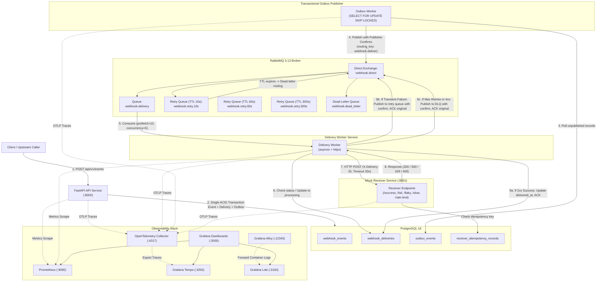

# Webhook Delivery Lab

A complete, production-grade, educational distributed systems laboratory built with **Python 3.12**, **FastAPI**, **RabbitMQ**, **PostgreSQL**, **SQLAlchemy 2.0 (async)**, and the **Grafana Observability Stack** (Prometheus, Grafana, Tempo, Loki, Alloy, and OpenTelemetry Collector).

This laboratory is designed for engineers seeking hands-on mastery of asynchronous queue semantics, distributed reliability patterns, failure handling, and end-to-end observability.

---

## Architecture Overview



---

## Service Catalog

| Service | Container | Internal Port | Host Port | Purpose |
|---|---|---|---|---|
| **API** | `api` | 8000 | `8000` | Accepts events, validates URLs, writes outbox transaction |
| **Worker** | `delivery-worker` | - | - | RabbitMQ consumer, executes HTTP delivery, manages retries |
| **Outbox Publisher** | `outbox-publisher` | - | - | Polls outbox records via `SKIP LOCKED`, publishes with confirms |
| **Receiver** | `receiver` | 8001 | `8001` | Mock external destination (success, 500, flaky, slow, 429, 400) |
| **PostgreSQL** | `postgres` | 5432 | `5432` | Relational storage for events, deliveries, outbox, idempotency |
| **RabbitMQ** | `rabbitmq` | 5672, 15672, 15692 | `5672`, `15672`, `15692` | Broker, Management UI, Prometheus exporter plugin |
| **Prometheus** | `prometheus` | 9090 | `9090` | Telemetry scraping, time-series storage, alert rules |
| **Grafana** | `grafana` | 3000 | `3000` | Dashboards, unified logs/traces/metrics UI |
| **Tempo** | `tempo` | 3200, 4317 | `3200` | High-volume distributed tracing backend |
| **Loki** | `loki` | 3100 | `3100` | Centralized log aggregation with label indexing |
| **Alloy** | `alloy` | 12345 | `12345` | Container log discovery and forwarding agent |
| **OTel Collector** | `otel-collector` | 4317, 4318, 8888, 8889 | `4317`, `4318` | Ingests OTLP telemetry and fans out to backends |

---

## Database Schema (PostgreSQL 16)

All tables are created and versioned strictly via Alembic migrations (`migrations/versions/001_initial.py`).

### 1. `webhook_events`
- `id` (UUID PK): Unique event identifier.
- `event_type` (VARCHAR(255), Index): Type of event (e.g. `order.created`).
- `payload` (JSONB): Raw event payload.
- `created_at` / `updated_at` (TIMESTAMPTZ): Audit timestamps.

### 2. `webhook_deliveries`
- `id` (UUID PK): Delivery attempt ID, used as the global idempotency key.
- `event_id` (UUID FK): References `webhook_events.id`.
- `endpoint_url` (VARCHAR(2048)): Destination URL.
- `status` (VARCHAR(50), Index): `pending`, `processing`, `delivered`, `failed`, `dead_lettered`.
- `attempts` (INTEGER): Attempt count (starts at 0, increments on execution).
- `max_attempts` (INTEGER): Maximum attempts allowed (default: 5).
- `next_retry_at` (TIMESTAMPTZ, Index): Timestamp of scheduled next attempt.
- `last_error` (TEXT): Error message or HTTP status description.
- `response_status_code` (INTEGER): HTTP status code from receiver.
- `delivered_at` (TIMESTAMPTZ): Set upon successful delivery.

### 3. `outbox_events`
- `id` (UUID PK): Outbox record identifier.
- `aggregate_id` (UUID): Maps to the `delivery_id`.
- `event_type` (VARCHAR(255)): Event type name.
- `payload` (JSONB): Metadata required for publishing to RabbitMQ.
- `published` (BOOLEAN, Index): True once broker confirms receipt.
- `published_at` (TIMESTAMPTZ): Timestamp when confirmed by broker.
- `attempts` (INTEGER): Number of publish attempts.
- `last_error` (TEXT): Details of any broker publish failure.

### 4. `receiver_idempotency_records`
- `delivery_id` (UUID PK): The delivery ID received.
- `received_at` (TIMESTAMPTZ): When the receiver first processed it.
- `endpoint` (VARCHAR(255)): The endpoint path called.
- `status_returned` (INTEGER): The HTTP status returned on the first call.

---

## RabbitMQ Topology Design

### Exchange
- **Name**: `webhook.direct`
- **Type**: `direct`
- **Durability**: Durable (`durable=True`)

### Queues & Bindings

| Queue Name | Durable | Routing Key | Arguments / TTL | Purpose |
|---|---|---|---|---|
| `webhook.delivery` | Yes | `webhook.deliver` | DLX: `webhook.direct`<br>DLK: `webhook.dead` | Primary delivery queue |
| `webhook.retry.10s` | Yes | `webhook.retry.10s` | TTL: 10,000ms<br>DLX: `webhook.direct`<br>DLK: `webhook.deliver` | Attempt 2 backoff |
| `webhook.retry.60s` | Yes | `webhook.retry.60s` | TTL: 60,000ms<br>DLX: `webhook.direct`<br>DLK: `webhook.deliver` | Attempt 3 backoff |
| `webhook.retry.300s`| Yes | `webhook.retry.300s`| TTL: 300,000ms<br>DLX: `webhook.direct`<br>DLK: `webhook.deliver` | Attempt 4 backoff |
| `webhook.dead_letter`| Yes | `webhook.dead` | None | Poison pill / terminal DLQ |

---

## Retry Strategy & Dead-Letter Flow

```
Attempt 1 (Immediate) 
   │
   ├── HTTP 2xx ──────────────────────────────────> Delivered (ACK)
   ├── Non-retryable (400, 401, 403, 404) ───────> Dead-Letter Queue (ACK)
   └── Transient Failure (5xx, 429, Timeout)
         │
         ▼
Attempt 2 (Wait 10s via webhook.retry.10s)
   │
   ├── HTTP 2xx ──────────────────────────────────> Delivered (ACK)
   └── Transient Failure
         │
         ▼
Attempt 3 (Wait 60s via webhook.retry.60s)
   │
   ├── HTTP 2xx ──────────────────────────────────> Delivered (ACK)
   └── Transient Failure
         │
         ▼
Attempt 4 (Wait 300s via webhook.retry.300s)
   │
   ├── HTTP 2xx ──────────────────────────────────> Delivered (ACK)
   └── Transient Failure
         │
         ▼
Attempt 5 (Final attempt)
   │
   ├── HTTP 2xx ──────────────────────────────────> Delivered (ACK)
   └── Failure ───────────────────────────────────> Dead-Letter Queue (ACK)
```

### Safe Publishing Before Ack
To avoid message loss, the delivery worker always publishes the retry or dead-letter message with **publisher confirms** *before* acknowledging the original incoming message.

---

## Transactional Outbox & Idempotency Patterns

### 1. The Dual-Write Problem
Attempting to write to PostgreSQL and RabbitMQ in separate operations creates an unavoidable failure mode if the process crashes between writes. The Transactional Outbox pattern writes both records inside **one local database transaction**.

### 2. Multi-Publisher Concurrency: `SELECT FOR UPDATE SKIP LOCKED`
The outbox publisher claims batches of unpublished records using:
```sql
SELECT * FROM outbox_events 
WHERE published = false AND attempts < 10
ORDER BY created_at ASC 
LIMIT 50 
FOR UPDATE SKIP LOCKED;
```
This guarantees that multiple outbox worker processes can run horizontally in parallel without locking each other or publishing duplicate jobs.

### 3. Receiver-Side Idempotency
Because network failures or crashes between HTTP response and RabbitMQ ACK can result in redeliveries (`redelivered=True`), the receiver stores the `delivery_id` and checks it on every call:
- If already seen: returns `200 OK {"status": "already_processed"}` without executing duplicate side-effects.

---

## Observability Architecture

### 1. Distributed Tracing with W3C Context Propagation
When a message passes through RabbitMQ, HTTP headers are absent. The application explicitly injects W3C Trace Context (`traceparent`) into RabbitMQ message headers upon publish, and extracts them inside the worker to continue the trace span.

### 2. Metrics (Prometheus)
- `webhook_events_received_total`: Total events received.
- `webhook_deliveries_succeeded_total`: Total successful deliveries.
- `webhook_deliveries_failed_total`: Total failed deliveries.
- `webhook_retries_total`: Count of retry hops scheduled.
- `webhook_dead_lettered_total`: Terminal failures sent to DLQ.
- `outbox_published_total` / `outbox_publish_failures_total`: Outbox publish metrics.
- `worker_active_jobs`: Active in-flight worker tasks.
- `outbox_pending_records`: Backlog in the outbox table.
- `webhook_delivery_duration_seconds`: HTTP round-trip latency histogram.

### 3. Structured JSON Logging
All logs output machine-readable JSON containing `service_name`, `environment`, `trace_id`, `span_id`, and `delivery_id`. Grafana Alloy collects them from Docker and forwards them to Loki.

---

## Quick Start with Docker Compose

### Prerequisites
- Docker and Docker Compose
- `curl` and `python3` (for local experiment scripts)

### 1. Clone and Configure
```bash
cp .env.example .env
```

### 2. Build and Start Services
```bash
make build
make up
```

### 3. Verify Health & Readiness
```bash
make health
make ready
```

---

## Web UIs & Local Endpoints

| Interface | URL | Credentials |
|---|---|---|
| **API Swagger UI** | http://localhost:8000/docs | None |
| **Receiver Swagger UI** | http://localhost:8001/docs | None |
| **RabbitMQ Management UI** | http://localhost:15672 | `webhook` / `webhook` |
| **Prometheus Web UI** | http://localhost:9090 | None |
| **Grafana Dashboards** | http://localhost:3000 | `admin` / `admin` |
| **Alloy UI** | http://localhost:12345 | None |

---

## API Usage Examples

### 1. Submit a Successful Event
```bash
curl -X POST http://localhost:8000/api/v1/events \
  -H "Content-Type: application/json" \
  -d '{
    "event_type": "order.created",
    "payload": {"order_id": "ORD-101", "amount": 1500},
    "endpoint_url": "http://receiver:8001/webhooks/success"
  }'
```

### 2. Submit a Failing Event (Retries -> DLQ)
```bash
curl -X POST http://localhost:8000/api/v1/events \
  -H "Content-Type: application/json" \
  -d '{
    "event_type": "payment.failed",
    "payload": {"payment_id": "PAY-999"},
    "endpoint_url": "http://receiver:8001/webhooks/fail"
  }'
```

### 3. Inspect a Delivery Record
```bash
curl -s http://localhost:8000/api/v1/deliveries/<DELIVERY_ID> | python3 -m json.tool
```

### 4. Replay a Failed or Dead-Lettered Delivery
```bash
curl -X POST http://localhost:8000/api/v1/deliveries/<DELIVERY_ID>/replay \
  -H "Content-Type: application/json" \
  -d '{"force": false}'
```

---

## Hands-on Failure Experiments

Run any of the 10 failure experiments from the `experiments/` directory:

```bash
# 1. Consumer crash & message redelivery
python experiments/01_consumer_crash.py --publish
python experiments/01_consumer_crash.py
python experiments/01_consumer_crash.py --recover

# 2. Duplicate delivery & receiver idempotency
python experiments/02_idempotency.py

# 3. Retry behaviour with flaky receiver
python experiments/03_retry_behaviour.py

# 4. Queue backlog & drain rate monitoring
python experiments/04_queue_backlog.py --count 200

# 5. Backpressure with slow consumers
python experiments/05_backpressure.py --count 25

# 6. Outbox recovery during broker outage
python experiments/06_outbox_recovery.py

# 7. Distributed tracing inspection
python experiments/07_distributed_tracing.py

# 8. Observability under failure (500, 400, 429)
python experiments/08_observability_failure.py

# 9. Graceful shutdown during in-flight delivery
python experiments/09_graceful_shutdown.py

# 10. Load testing (RPS & p95 latency)
python experiments/load_test.py --count 500 --concurrency 25

# Bonus: RabbitMQ Exchange types (Direct, Fanout, Topic)
python experiments/exchange_demo.py
```

---

## Makefile Reference

```bash
make help               # Display list of all available commands
make build              # Build all Docker container images
make up                 # Start all 12 services in the background
make down               # Stop all services
make restart            # Restart all containers
make logs               # Follow logs across all services
make logs-api           # Follow API logs
make logs-worker        # Follow delivery worker logs
make logs-outbox        # Follow outbox publisher logs
make logs-receiver      # Follow mock receiver logs
make ps                 # Show container statuses
make migrate            # Apply database migrations
make migrate-new NAME=x # Generate a new Alembic migration
make db-shell           # Open interactive psql shell
make db-deliveries      # View recent deliveries in PostgreSQL
make db-outbox          # View pending outbox records
make test-unit          # Run unit test suite
make test-integration   # Run integration tests
make submit-event       # Submit a test webhook event
make deliveries         # List deliveries via API
make dlq-info           # Show RabbitMQ DLQ message count
make clean-volumes      # Purge all volumes (database reset)
```

---

## Security & SSRF Protection

1. **SSRF Guard**: The API validates webhook destination URLs against an allowlist configured via `ALLOWED_ENDPOINT_PREFIXES`. Any destination outside the allowlist returns `422 Unprocessable Entity` to prevent Server-Side Request Forgery.
2. **Credential Safety**: Development credentials (`webhook`/`webhook`, `admin`/`admin`) are provided for ease of local experimentation only. Always supply custom credentials via environment variables before deploying to production.
