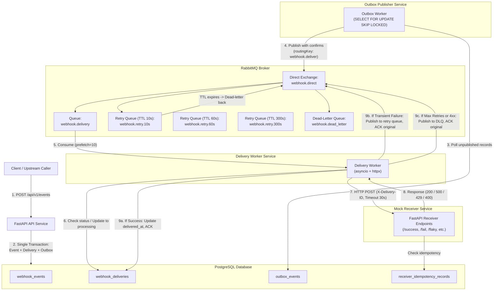

# Webhook Delivery Lab — Architecture & System Design

## 1. System Overview

The **Webhook Delivery Lab** is an educational, distributed backend project designed to demonstrate message-oriented architectures, resilience patterns, asynchronous processing, and full-stack observability.

The system is composed of three custom logical applications running alongside production-grade infrastructure:

1. **API Service (`app.api`)**: Accepts webhook delivery requests, validates inputs, and commits events to PostgreSQL alongside an Outbox record.
2. **Transactional Outbox Publisher (`app.workers.outbox_worker`)**: Polls unpublished outbox records using `SELECT FOR UPDATE SKIP LOCKED` and publishes them to RabbitMQ with publisher confirms.
3. **Delivery Worker (`app.workers.delivery_worker`)**: Consumes jobs from RabbitMQ, executes HTTP deliveries with timeouts, handles retry backoff via TTL queues, records delivery state in PostgreSQL, and routes exhausted jobs to DLQ.
4. **Mock Receiver Service (`receiver.main`)**: Simulates remote external systems with configurable behaviors (success, 500 fail, flaky, slow, rate-limiting, and bad request), maintaining receiver-side idempotency records.

---

## 2. End-to-End Workflow & Architecture Diagram

---

## 3. Database Schema

All tables are managed strictly through **Alembic migrations** (no `create_all()`).

### `webhook_events`
Represents the original business domain event submitted to the API.
- `id` (UUID, Primary Key)
- `event_type` (VARCHAR(255), Indexed)
- `payload` (JSONB)
- `created_at` (TIMESTAMPTZ, Default: now())
- `updated_at` (TIMESTAMPTZ, Default: now())

### `webhook_deliveries`
Tracks the delivery attempt lifecycle for a specific destination endpoint.
- `id` (UUID, Primary Key)
- `event_id` (UUID, Foreign Key -> `webhook_events.id`)
- `endpoint_url` (VARCHAR(2048))
- `status` (VARCHAR(50), Indexed): `pending`, `processing`, `delivered`, `failed`, `dead_lettered`
- `attempts` (INTEGER, Default: 0)
- `max_attempts` (INTEGER, Default: 5)
- `next_retry_at` (TIMESTAMPTZ, Nullable, Indexed)
- `last_error` (TEXT, Nullable)
- `response_status_code` (INTEGER, Nullable)
- `created_at` (TIMESTAMPTZ)
- `updated_at` (TIMESTAMPTZ)
- `delivered_at` (TIMESTAMPTZ, Nullable)

### `outbox_events`
Implements the Transactional Outbox pattern to prevent the dual-write problem.
- `id` (UUID, Primary Key)
- `aggregate_id` (UUID) - Points to `delivery_id`
- `event_type` (VARCHAR(255))
- `payload` (JSONB)
- `published` (BOOLEAN, Default: false, Indexed)
- `created_at` (TIMESTAMPTZ, Indexed)
- `published_at` (TIMESTAMPTZ, Nullable)
- `attempts` (INTEGER, Default: 0)
- `last_error` (TEXT, Nullable)

### `receiver_idempotency_records`
Used by the receiver to guarantee idempotent request handling under redeliveries.
- `delivery_id` (UUID, Primary Key)
- `received_at` (TIMESTAMPTZ)
- `endpoint` (VARCHAR(255))
- `status_returned` (INTEGER)

---

## 4. Asynchronous Concurrency Model

1. **API Service**: Non-blocking async endpoints using FastAPI, Asyncpg, and SQLAlchemy 2.0 async sessions.
2. **Outbox Worker**: Periodic async polling loop using `SELECT FOR UPDATE SKIP LOCKED`, permitting horizontal scaling of publishers without message contention.
3. **Delivery Worker**: Single RabbitMQ robust channel with configured `prefetch_count` (e.g. 10) and an `asyncio.Semaphore` (e.g. 5) to control concurrent in-flight HTTP requests. Each task runs within an isolated database session.
